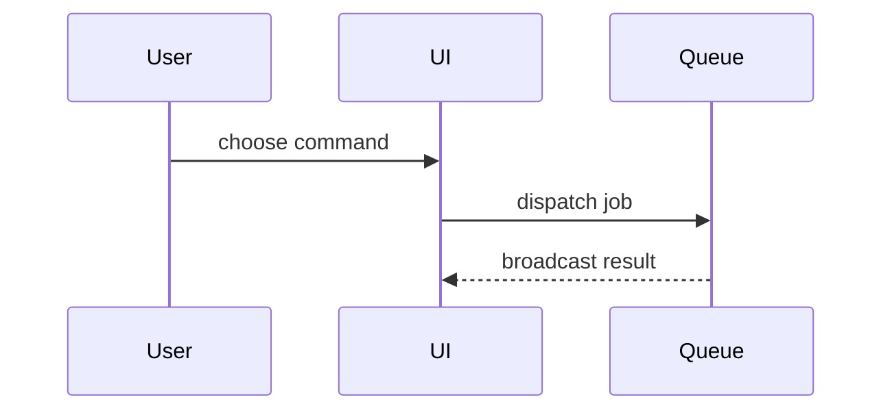

Open a merge request for the current branch with `glab`, which infers the project from `git remote -v`. For anything beyond the commands below, call the Skill tool with "gitlab-cli-skills".

## Process

1. **Find the target.** The target branch is the project's default branch (`glab repo view --output json`, field `default_branch`) unless the user named another. Stop if the current branch is the target.

2. **Read the whole change.** Read `git log <target>..HEAD` and `git diff <target>...HEAD`, every commit and every file. Read `CONTEXT.md` (or `CONTEXT-MAP.md` and the files it points to) if it exists, and use its domain vocabulary in the body. Done when you can say what each changed file is for.

3. **Find the issue.** Look for an issue number in the branch name, the commit messages, and the conversation. If you find one, read it with `glab issue view <n>` and put `Closes #<n>` as the last line of the body.

4. **Write the title and body.** The title is one imperative line that names the outcome, like a commit subject. Write the body to a file in the scratchpad using the template below. The body never mentions Claude Code and has no attribution line.

5. **Push and open.** Push with `git push -u origin HEAD`. Then check for an open merge request with `glab mr list --source-branch "$(git branch --show-current)"`.
   - None open: `glab mr create --title "..." --description-file <file> --target-branch <target> --remove-source-branch --yes`. Add `--draft` when the user asked for a draft or the work is unfinished.
   - One open: `glab mr update <n> --title "..." --description-file <file>`.

   Upload each screenshot with `--attach <path>`, which adds it to the end of the description.

6. **Report** the merge request URL.

## Template

```markdown
## Summary

<diagram, diff-sketch, or tree>

## Evidence

- **Before:** <screenshot/output/failing test run>
  **After:** <screenshot/output/passing test run>

## Merge Danger

**Door:** <one-way or two-way>

<optional: description>

**Blast Radius:** <one-word description>

<optional: potential ramifications of merge>
```

## Sections

Skip all preambles and keep prose brief.

### Summary

Pick the smallest view that makes the key point clear.

- Show logic or an algorithm as pseudocode:

```text
on(save)
  if content is unchanged
    return cached result
  write new content
  return fresh result
```

- Show runtime control flow as a call tree:

```text
submitForm
  createSession
    persistPrompt
    launchAgent
  navigateToSession
```

- Show UI structure as a component tree, including state and module boundaries that matter:

```text
<SessionPage> (resources/js/Pages/Session.vue)
  useSessionEvents()
  <SessionToolbar>
    <RunSkillButton> (resources/js/Components)
```

- Show file responsibility or a broad refactor as a shallow file tree:

```text
app/
├── Actions/       # one business operation each
├── Models/        # own persisted state
└── Http/          # receives requests
```

- Show component interaction, control flow, or data flow with Mermaid, which GitLab renders:



- Use `diff` when the point is what changes and the surrounding shape already exists. Match the diff shape to the topic.

For a component change:

```diff
 <SessionPage>
   useSessionEvents()
   <SessionToolbar>
+    <RunSkillButton />
   <SessionTimeline>
+    <SkillResultCard />
```

For a file-layout change:

```diff
 app/
 ├── Actions/
+│   └── ExpandSkill.php   # expands the slash command
 ├── Models/
-└── Transport.php
+└── Transport/
+    ├── Client.php
+    └── Stream.php
```

For a call-tree or call-stack change:

```diff
 submitForm
   createSession
     persistPrompt
+    expandSkillMention
     launchAgent
-  navigateToSession
+  navigateToSession
+    subscribeToEvents
```

For a state or control-flow change:

```diff
 on(save)
-  write content
+  if content is unchanged
+    return cached result
+  write new content
+  invalidate cache
```

- Show the whole block when most of it is new, when omitted context would hide ownership or order, or when the reviewer needs a copyable target shape:

```php
function expandSkill(string $command): string
{
    $skillName = substr($command, 1);

    return "use the {$skillName} skill";
}
```

#### Guidance

Place each visual next to the short text it supports. Keep only the calls, files, props, states, and boundaries the reviewer needs to understand the change.

You may use one of these, you may use several, it is unlikely you will use all of them. Use your judgement and don't overwhelm the reviewer.

### Evidence

Concrete evidence that the change works. Show a before and after.

Screenshots are S-tier, when the environment is set up for it and the change is visual. Attach them with `--attach`.

Execution-based evidence is A-tier: test results, console output. Show the exact test that now fails and passes, using pseudocode.

### Merge Danger

Describe whether it's a one-way or two-way door. You can walk back through two-way doors, but not one-way doors. A merge request that is cheap to roll back is lower risk. Changes that involve destructive actions or hard-to-reverse decisions, such as a migration that drops data, are one-way doors.

The blast radius is the potential impact or scope of the changes introduced by this merge request. Consider all possibilities. Examples are layout shift, breakages for consumers, mobile responsiveness, etc.
